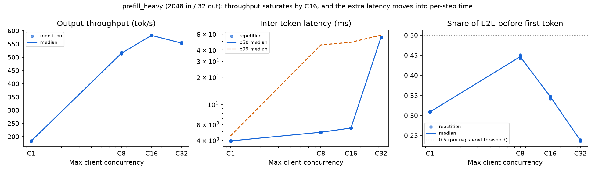
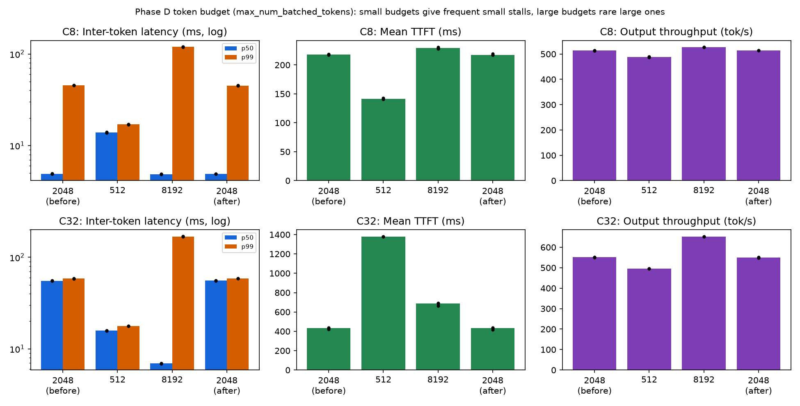

# BottleneckShift

**A pre-registered study of bottleneck shifts in LLM inference serving**

> When an LLM inference service slows down, can controlled experiments tell workload
> effects apart from resource contention, and identify when the dominant bottleneck
> shifts?

BottleneckShift runs controlled experiments on [vLLM](https://github.com/vllm-project/vllm)
and measures every run from the client, the server's phase timings, and GPU/CPU
telemetry. It uses only public software and generated prompts, with no proprietary
code, data, or results.

**Technical report:** [Where Does the Inference Time Go? Queueing, Prefill, and Per-Step
Cost in LLM Serving](paper/bottleneckshift-report.pdf) (PDF, 9 pages including
references; source in [`paper/`](paper/)).

## What we learned

- Under load, latency depends on how the scheduler splits prompt work into engine
  steps (scheduler iterations) and on how long each step takes, as well as on
  concurrency.
- The token budget trades median against tail: at 32 requests, the budget with the
  best median ITL (7 ms) had the worst p99 (169 ms), so a median alone can mislead.
- Client and GPU metrics show the added latency, and a per-step scheduler log
  traces it to steps that carry prompt work.

Which phase dominates decides what to tune: the wait for the first token, or the
per-step time that sets how smoothly tokens stream.

## Findings

All on one RTX A4000 with vLLM 0.29.0 serving Qwen2.5-0.5B-Instruct. Inter-token
latency (ITL) is the gap between consecutive streamed outputs of a request; the token
budget is vLLM's `max_num_batched_tokens`, the most tokens one engine step may process.

1. **Decode dominates each request, even with long prompts.** With 2048-token prompts
   and 32-token outputs, a lone request spends about 40 ms in prefill and 122 ms in
   decode, as a FLOP and bandwidth estimate predicts.
   ([Phase B](reports/milestone3-20261003T180358Z-phase-b.md))
2. **Past saturation, added latency moves into per-step time.** From 8 to 32
   requests, median ITL rises from 4.9 to 55 ms and the share of latency before the
   first token falls from 0.44 to 0.24, against the pre-registered prediction.
   ([Phase C](reports/milestone3-20261003T201214Z-phase-c.md),
   [Phase D](reports/milestone3-20261006T022744Z-phase-d.md))
3. **The token budget trades median against tail.** At 32 requests, 8192 tokens gives
   a 7 ms median ITL and 18% more throughput but a 169 ms p99; 512 evens out ITL but
   triples TTFT. Part of the pre-registered tail prediction failed.
   ([Phase D](reports/milestone3-20261006T022744Z-phase-d.md),
   [Milestone 5 pilot](reports/milestone5-20261025T004640Z-pilot.md),
   [Part 2](reports/milestone5p2-20261029T000043Z-part2.md))
4. **A step's cost grows with its tokens and their context.** A 1024-token chunk took
   19.5 ms at context 1024 and 36 ms at 7168. The pre-registered token-count test
   failed at 8 requests, and its pass at 32 used a timing measure that lags by one
   step. A post hoc step-cost model predicts ITL p99 at 8 requests within 5%.
   ([Part 2](reports/milestone5p2-20261029T000043Z-part2.md),
   [reanalysis](reports/reanalysis-20261028.md))
5. **Under closed-loop load, GPU contention looks different from added load.** A
   co-located job at a 50% duty cycle costs 13–15% end-to-end latency, while
   `nvidia-smi` utilization, already near 90%, moves only 1–6 points. At 8 requests,
   queue time rose only 6%, against the pre-registered prediction.
   ([Phase C](reports/milestone3-20261003T201214Z-phase-c.md))





More figures: [`reports/figures/`](reports/figures/README.md). Related work is in
Section 11 of the [technical report](paper/bottleneckshift-report.pdf).

## Method

- Each protocol is merged before its data are collected
  ([`experiments/`](experiments/roadmap.md)), and every report scores every
  prediction, including the failures.
- Factors change one at a time, with three repetitions.
- Series are validated before analysis, and interventions get a sham condition and a
  recovery baseline.

## Status

Milestones 1–3 and the Milestone 5 pilot are complete, with a post hoc reanalysis;
Milestone 4 is deferred, and the full Milestones 5–9 are proposed. Details:
[roadmap](experiments/roadmap.md).

## Reproduce

Linux, Python 3.11, and a CUDA GPU supported by the pinned vLLM release:

```bash
python3.11 -m venv .venv && source .venv/bin/activate
python -m pip install -r requirements.txt && python -m pip install -e '.[test]'
python scripts/run_experiment.py --config configs/milestone1-forward.toml \
  --series-id DEVICE-MODEL-forward-01 --dry-run
```

Full guide: [`docs/reproduce.md`](docs/reproduce.md). Raw data aren't in this
repository; each report gives the archive name and checksum.

## Limitations

One model, one GPU, and one vLLM version. Load is closed-loop, client and server
share a host, and prompts are generated. Findings are measured associations under
controlled changes; server metrics and telemetry support them but don't prove
causation.
