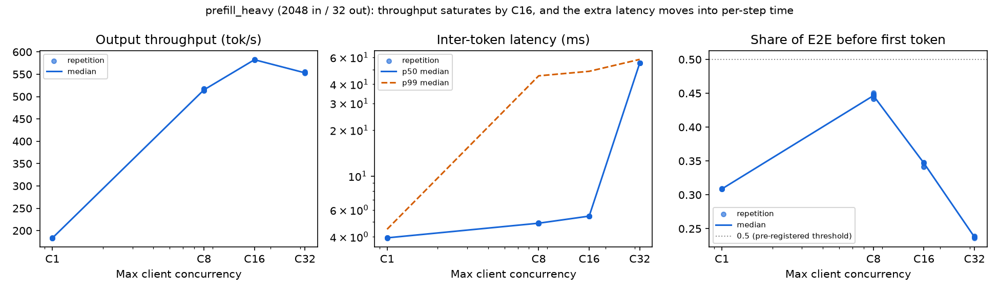

# BottleneckShift

**A pre-registered study of bottleneck shifts in LLM inference serving**

> When an LLM inference service slows down, can controlled experiments tell workload
> effects apart from resource contention, and identify when the dominant bottleneck
> shifts?

BottleneckShift runs controlled experiments on [vLLM](https://github.com/vllm-project/vllm)
and measures every run three ways: from the client, from the server's own phase
timings, and from GPU/CPU telemetry. The goal is experimental diagnosis. Everything
here uses public software, generated prompts, and independent experiments, with no
proprietary code, data, or results.

**Technical report:** [Where Does the Time Go? A Pre-Registered Study of Per-Step Cost
in LLM Inference Serving](paper/bottleneckshift-report.pdf) (PDF, 9 pages including
references; source in [`paper/`](paper/)).

## Why it matters

Serving systems are tuned for different goals. DistServe, for example, sets separate
time-to-first-token (TTFT) and time-per-output-token (TPOT) targets for chatbot,
code-completion, and summarization services [[3]](#related-work). Knowing which phase of
a request dominates, and when that changes, decides what to tune:

- **Interactive chat and coding assistants.** Users feel both the wait for the first
  token and how smoothly tokens stream. Under load, the delay moves into per-step
  generation, and the scheduler's token budget shifts that cost between median and tail
  latency (finding 2).
- **Long-prompt workloads such as retrieval-augmented generation.** A workload that
  looks prefill-heavy can still be dominated by decode (finding 1).
- **Shared GPUs.** Multi-tenant clusters co-locate work with MPS or time slicing
  [[8]](#related-work). A co-located job slows inference in ways that GPU utilization
  barely shows (finding 3).
- **Capacity planning and autoscaling.** Throughput at high concurrency depends on the
  scheduler's token budget: at 32 requests, raising it from the default 2048 to 8192
  gave 18% more throughput (finding 2).

## Findings so far

All on one GPU with a 0.5B model (Qwen2.5-0.5B-Instruct on an RTX A4000).

1. **Decode dominates each request's end-to-end latency, even with long prompts.** With
   2048-token prompts and 32-token outputs, a request running alone spends about 40 ms
   in prefill and about 122 ms in its 31 generation steps. At 8 concurrent requests,
   much of a request's decode time is spent in steps that also carry other requests'
   prefill chunks. ([Phase B](reports/milestone3-20261003T180358Z-phase-b.md))
2. **From 8 to 32 concurrent requests, past saturation, added latency moves into
   per-step time.** Median inter-token latency (ITL) rises from 4.9 to 55 ms, while the
   share of latency before the first token falls from 0.44 to 0.24, against the
   pre-registered prediction. The shift is bounded: once every step is full, further
   load must go into the wait for the first token. Changing vLLM's per-step token
   budget reshapes this cost: at 32 requests, 8192 tokens gives a 7 ms median ITL and
   18% more throughput but a 169 ms p99, while 512 evens out ITL but triples TTFT, and
   queueing takes two thirds of each request's latency. A follow-up pilot that logged
   every engine step showed that the budget sets the scale of the tail at 32 requests.
   Its primary tail prediction failed in one part: short prompts were packed two per
   step instead of making steps smaller. Its test of whether a step's cost tracks the
   tokens it schedules passed at 32 requests, but the step timing it used turned out to
   be confounded with the previous step, and the same test was rejected at 8 requests.
   A post hoc [reanalysis](reports/reanalysis-20261028.md) with per-step execution time
   supports the relation, and a simple step-cost model fit on one-request data predicts
   ITL p99 at 8 requests within 5%.
   A second part timed each prompt chunk directly, one request at a time, and showed
   that a chunk's cost grows with its context, in line with a count of attention FLOPs:
   a 1024-token chunk took 19.5 ms at context 1024 and 36 ms at context 7168.
   ([Phase C](reports/milestone3-20261003T201214Z-phase-c.md),
   [Phase D](reports/milestone3-20261006T022744Z-phase-d.md),
   [Milestone 5 pilot](reports/milestone5-20261025T004640Z-pilot.md),
   [Part 2](reports/milestone5p2-20261029T000043Z-part2.md))
3. **Under closed-loop load, GPU contention looks different from added load.** A
   co-located process at a 50% duty cycle costs 13–15% end-to-end latency. It slows
   single requests too and, with one request at a time, slows prefill more than decode,
   while `nvidia-smi` utilization, already near 90%, moves only 1–6 points. At 8 requests, queue time rose
   only 6%, against the pre-registered prediction that it would rise more than prefill.
   ([Phase C](reports/milestone3-20261003T201214Z-phase-c.md))




More figures, including the contention series: [`reports/figures/`](reports/figures/README.md).

## Method

- **Pre-registration.** Each protocol is merged before its data are collected
  ([`experiments/`](experiments/roadmap.md)), and every report scores every prediction,
  including the ones that failed. Milestones 1 and 2 state expected signatures;
  numbered predictions and falsification criteria start with Milestone 3.
- **One factor at a time,** with three repetitions, in forward and reverse order where
  the design allows. From
  Milestone 2 onward, runs use a pinned model revision, prefix caching off, and
  explicit sampling.
- **Three views of every run from Milestone 3 onward:** client request timings, vLLM's
  server-side `/metrics` histograms (queue, prefill, decode), and GPU/CPU telemetry.
- **Validation before analysis.** Request counts, failures, token lengths, server
  counts, and telemetry coverage are checked, and analysis refuses an unvalidated
  series. Raw data are archived with checksums.
- **Controls for interventions (from Milestone 3 Phase C):** a sham condition and a
  recovery baseline.

## Related work

1. Yu et al., [Orca](https://www.usenix.org/conference/osdi22/presentation/yu), OSDI
   2022: iteration-level scheduling, the batching model vLLM builds on.
2. Kwon et al., [vLLM / PagedAttention](https://arxiv.org/abs/2309.06180), SOSP 2023:
   the serving system under study.
3. Zhong et al., [DistServe](https://arxiv.org/abs/2401.09670), OSDI 2024: prefill and
   decode interfere, and services set different TTFT and TPOT targets. This study
   measures that interference on one GPU.
4. Agrawal et al., [Sarathi-Serve](https://arxiv.org/abs/2403.02310), OSDI 2024: chunked
   prefill and the per-step token budget. Finding 2 measures that trade-off directly.
5. Agrawal et al., [Etalon](https://arxiv.org/abs/2407.07000), 2024: averaged metrics
   such as TPOT hide jitter. Here, the token budget with the best median ITL has the
   worst p99.
6. Dean and Barroso, [The Tail at Scale](https://doi.org/10.1145/2408776.2408794), CACM
   2013: why tail latency, not the average, shapes user experience.
7. Hoefler and Belli,
   [Scientific Benchmarking of Parallel Computing Systems](https://doi.org/10.1145/2807591.2807644),
   SC 2015: the reporting and repetition practices this study follows.
8. NVIDIA, [Multi-Process Service](https://docs.nvidia.com/deploy/mps/index.html) and
   [GPU time slicing](https://docs.nvidia.com/datacenter/cloud-native/gpu-operator/latest/gpu-sharing.html):
   the GPU-sharing mechanisms behind the contention scenario.

Each report has a related-evidence section that checks its findings against these and
other sources; the [Phase C report](reports/milestone3-20261003T201214Z-phase-c.md) is
the most complete.

## Status and next steps

| Milestone | Question | Status |
|---|---|---|
| 1–2 | Concurrency effect, then repeated under explicit cache, sampling, and model controls | Complete ([1](reports/milestone1-20261001T205137Z.md), [2](reports/milestone2-20261003T034456Z.md)) |
| 3 | Workload regimes, concurrency crossover, GPU contention, token-budget intervention | Complete ([B](reports/milestone3-20261003T180358Z-phase-b.md), [C](reports/milestone3-20261003T201214Z-phase-c.md), [D](reports/milestone3-20261006T022744Z-phase-d.md)) |
| 4 | Measurement-driven backend selection | Deferred: entry gate not met ([roadmap](experiments/roadmap.md)) |
| 5 (pilot) | Prompt length versus token budget, with a per-step scheduler log | Complete: C32 block ([report](reports/milestone5-20261025T004640Z-pilot.md)); Part 2, the C8 block and a context-length test ([report](reports/milestone5p2-20261029T000043Z-part2.md)) |
| Reanalysis | Post hoc: step timing, a step-cost model, uncertainty, steady state, clocks | Complete ([report](reports/reanalysis-20261028.md)) |
| 5–9 | Full workload-shape study, network, host contention, GPU contention, crossed factors | Proposed |

Proposed milestones have no data yet, and each needs its own pre-registered protocol
first. Scope and status: [roadmap](experiments/roadmap.md).

## Reproduce

Linux, Python 3.11, and a CUDA GPU supported by the pinned vLLM release:

```bash
python3.11 -m venv .venv && source .venv/bin/activate
python -m pip install -r requirements.txt && python -m pip install -e '.[test]'
python scripts/run_experiment.py --config configs/milestone1-forward.toml \
  --series-id DEVICE-MODEL-forward-01 --dry-run
```

The full guide (preflight, runs, validation, analysis, and instrumentation) is in
[`docs/reproduce.md`](docs/reproduce.md). Raw data aren't in this repository; each
report's artifact record gives the archive name and checksum.

## Limitations

One model, one GPU, and one framework version limit generality. Load is closed-loop,
client and server share a host (so there's no network realism), and prompts are
generated. Findings are measured associations under controlled changes; server
metrics and telemetry corroborate them but don't prove causation on their own.

## Repository layout

`configs/` experiment inputs · `scripts/` orchestration around the vLLM CLI ·
`src/bottleneckshift/` validation, manifests, and parsers · `analysis/` post-processing
and figures · `experiments/` protocols written before running · `reports/` scored
results · `docs/` [glossary](docs/glossary.md), [reproduction guide](docs/reproduce.md),
and [workflow](docs/milestone-workflow.md).
