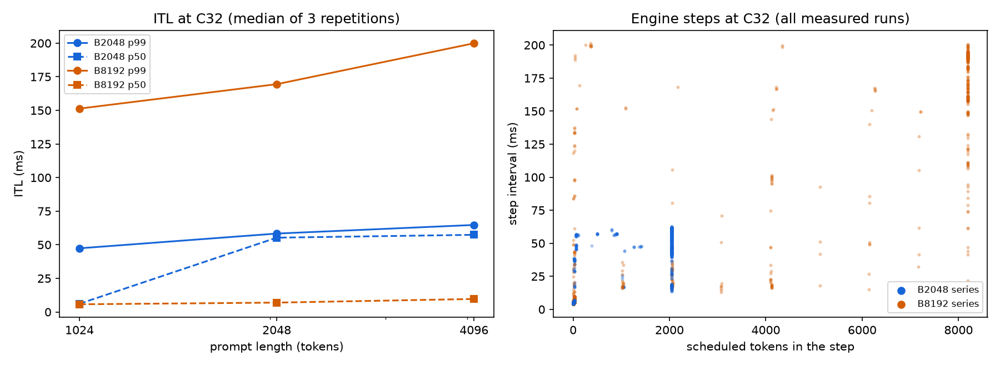

# BottleneckShift Milestone 5 pilot: prompt length versus token budget

## Result

A per-step scheduler log confirmed, for the first time in this study, that **an engine
step's cost tracks the number of tokens it schedules.** Pooled over the seven series,
steps with at least 1024 tokens took a median 56 ms against 5.7 ms for steps with at
most 64 tokens (9.8×). The Spearman correlation between a step's tokens and its
interval was 0.87. This is the step-size explanation that Phase D could not test.

The token budget sets the tail of inter-token latency (ITL) much as predicted:
- **At B2048, the tail stops growing past the budget.** ITL p99 is 58 ms for
  2048-token prompts and 65 ms for 4096-token prompts (+11%).
- **At B8192, the tail is about 3× higher** (170 ms and 200 ms), while the median is
  below 10 ms.

**The primary tail prediction (prediction 3) was not confirmed, however.** The tail
for 1024-token prompts was only 19% lower than for 2048-token prompts, against a
pre-registered threshold of at least 25%. The step log shows why: the scheduler put
two 1024-token prompts into one 2048-token step, so short prompts did not make steps
smaller. Those packed steps were cheaper (45 ms against 55.5 ms for the same 2048
tokens), which points to a second factor beyond the token count, the prompt's context
length. That reading is post hoc.

Seven of the eight C32-block predictions held, and the anchor reproduces Phase D within
0.5%. The optional C8 block was not run, so predictions 8–10 are not scored.

## Terms used in this report

| Term | Meaning |
|---|---|
| TTFT / E2E | Time to first token / end-to-end latency, from the client; "mean" values average over a run's requests |
| ITL p50 / p99 | Median / 99th percentile of the gaps between streamed tokens, as reported by vLLM's benchmark for each run |
| C32 | Maximum client concurrency of 32 requests in flight |
| L | Prompt length in tokens (1024, 2048, or 4096), with 32-token outputs and 100 prompts per run |
| B, token budget | `max_num_batched_tokens`: the most tokens one engine step may schedule, decodes plus prompt chunks. vLLM's default on this GPU is 2048 |
| Engine step | One scheduler iteration of the vLLM engine |
| Step log | `steps.jsonl`, written by the opt-in plugin `src/bottleneckshift/vllm_steplog.py`: one line per step with its scheduled tokens (prefill and decode), request counts, and times |
| Step interval | Time from one logged step's start to the next step's start, within a run (last step dropped; gaps over 1 s excluded) |
| Large / small step | A step scheduling at least 1024 / at most 64 tokens |
| `anchor-before`, `anchor-after` | The L2048/B2048 series run first and last, to reproduce Phase D and bracket drift |
| `lenL-budgetB-c32` | The series for prompt length L at budget B |

Full definitions and defaults: [`docs/glossary.md`](../docs/glossary.md).

## Provenance and protocol

- **Session:** `milestone5-20261025T004640Z`, seven series, 2026-10-25 00:49–01:16 UTC.
- **Protocol:** [`experiments/milestone5.md`](../experiments/milestone5.md),
  pre-registered in PR #24, merged 2026-10-25 00:24 UTC (2026-10-24 17:24 PDT) as
  `57fb0d1`, before any Milestone 5 data. No amendments.
- **Code:** commit `57fb0d1`, clean worktree, recorded in every manifest.
- **Host:** Hyperstack RTX A4000 (15,352 MiB), driver 580.196.07, Linux 6.14; Python
  3.12.3, vLLM 0.29.0, PyTorch 2.13.0, transformers 5.20.2.
- **Controls:** as in Phase D: pinned model revision
  `7ae557604adf67be50417f59c2c2f167def9a775`, prefix caching off (confirmed in every
  `server.log`), `--generation-config vllm`, greedy sampling, seed 2027, three
  repetitions, 15-second cooldowns, a 32-prompt warm-up at C32, `/metrics` scrapes, and
  GPU and CPU samplers. Each `server.log` records the configured budget (2048 or 8192).
- **Series order (pre-registered):** `anchor-before`, `len1024-budget2048-c32`,
  `len4096-budget8192-c32`, `len4096-budget2048-c32`, `len1024-budget8192-c32`,
  `len2048-budget8192-c32`, `anchor-after`.

## Validation

| Check | Result |
|---|---|
| Measured / warm-up requests | 2,100 measured (7 series × 3 runs × 100); 224 warm-up (7 × 32) |
| Failures, token lengths | Zero failures; exact configured input and output lengths |
| Server count = prompts | Yes, every run (2,324 server requests, including warm-ups) |
| Telemetry max gap | 0.21 s GPU, 1.0 s CPU |
| Step log | Present for every series, with steps in every measured run |
| Archive SHA-256 verified after transfer | Yes (`shasum -a 256 -c`: OK); all seven series also revalidated on the laptop |

## Measurements

Medians across three repetitions, with the repetition range.

| Series | L | B | Output tok/s | ITL p50 (ms) | ITL p99 (ms) | Mean TTFT (ms) | Mean E2E (ms) |
|---|---:|---:|---:|---:|---:|---:|---:|
| anchor-before | 2048 | 2048 | 553.3 (552.1–555.5) | 55.3 (54.9–55.3) | 58.3 (57.8–58.6) | 420.2 (420.1–434.2) | 1818.8 (1811.5–1822.7) |
| len1024-budget2048 | 1024 | 2048 | 1141.2 (1136.5–1146.9) | 6.1 (5.9–6.2) | 47.4 (47.3–47.7) | 267.0 (260.3–285.4) | 852.5 (850.9–857.5) |
| len4096-budget2048 | 4096 | 2048 | 270.3 (270.0–271.5) | 57.4 (57.4–57.7) | 64.7 (64.4–64.8) | 1927.4 (1920.2–1931.7) | 3596.1 (3580.6–3600.4) |
| len1024-budget8192 | 1024 | 8192 | 1209.4 (1187.4–1226.4) | 5.7 (5.7–5.7) | 151.3 (150.9–152.1) | 377.0 (375.1–389.7) | 780.5 (770.6–800.5) |
| len2048-budget8192 | 2048 | 8192 | 654.8 (651.6–655.9) | 7.0 (6.9–7.0) | 169.5 (169.0–169.7) | 702.0 (697.7–708.4) | 1481.0 (1477.0–1493.6) |
| len4096-budget8192 | 4096 | 8192 | 306.6 (306.2–307.4) | 9.7 (9.5–9.8) | 199.9 (198.7–200.2) | 1135.3 (1117.8–1163.0) | 3257.1 (3256.9–3270.5) |
| anchor-after | 2048 | 2048 | 551.5 (550.7–552.5) | 54.8 (54.5–55.4) | 58.7 (58.4–58.9) | 434.0 (423.4–436.9) | 1824.7 (1819.5–1824.8) |

Step log, all measured runs of each series:

| Series | Steps per run | Steps carrying prefill | Median tokens of a prefill step | Largest step | Large-step interval (ms) | Small-step interval (ms) |
|---|---:|---:|---:|---:|---:|---:|
| anchor-before | 141 | 77% | 2048 | 2048 | 55.5 | 5.7 |
| len1024-budget2048 | 143 | 38% | 2048 | 2048 | 44.9 | 5.7 |
| len4096-budget2048 | 233 | 87% | 2048 | 2048 | 57.7 | 5.6 |
| len1024-budget8192 | 145 | 16% | 4098 | 8192 | 46.3 | 5.6 |
| len2048-budget8192 | 148 | 22% | 8192 | 8192 | 157.6 | 6.8 |
| len4096-budget8192 | 145 | 40% | 8192 | 8192 | 189.9 | 9.1 |
| anchor-after | 142 | 77% | 2048 | 2048 | 55.4 | 5.7 |

*Left: ITL p50 and p99 at C32 by prompt length, for each budget; the L2048/B2048 point
is `anchor-before`. Right: every measured engine step's interval against its scheduled
tokens, as pre-registered (interval to the next step's start).* Figure provenance:
[`figures/README.md`](figures/README.md).

## Predictions vs observed

| # | Prediction | Observed | Verdict |
|---|---|---|---|
| 1 | Manipulation and instrument check: no step exceeds B; each run's logged prefill within 1% of 100 × L | Largest step exactly 2048 or 8192; logged prefill equals 100 × L exactly in all 21 runs | **Confirmed** |
| 2 (primary) | Pooled: large-step median interval ≥ 3× small-step; Spearman ≥ 0.7; the 3× ratio in each series with ≥ 30 of each | Pooled 56.3 vs 5.7 ms (9.8×), Spearman 0.87; per series 7.9× to 23× (all seven had ≥ 30 of each) | **Confirmed** |
| 3 | At B2048: p99 for L1024 at least 25% lower than L2048; L4096 within ±20% of L2048 | L1024 47.4 vs 58.3 ms (18.7% lower); L4096 64.7 ms (+11.0%) | **Not confirmed** (L4096 part held; L1024 part failed) |
| 4 | For L2048 and L4096, p99 at B8192 ≥ 1.5× B2048 | 169.5 / 58.3 = 2.9×; 199.9 / 64.7 = 3.1× | **Confirmed** |
| 5 | For L2048 and L4096, p50 < 10 ms at B8192 and ≥ 20 ms at B2048 | B8192: 7.0 and 9.7 ms; B2048: 55.3 and 57.4 ms | **Confirmed** |
| 6 | Anchor within 5% of Phase D's `budget-2048-before` at C32 (ITL p50, mean E2E, throughput) | 55.3 vs 55.4 ms (−0.2%); 1818.8 vs 1827.1 ms (−0.5%); 553.3 vs 550.8 tok/s (+0.5%) | **Confirmed** |
| 7 | `anchor-after` within 2% of `anchor-before` (mean E2E, throughput) | +0.3% and −0.3% | **Confirmed** |
| 8–10 | C8 block | Not run (time) | **Not scored** |

The Phase D values in prediction 6 were recomputed from the Phase D archive with the
same definitions as this report (median across repetitions of vLLM's per-run values).

**Falsification.** Predictions 1 and 2 hold, so the rule that would reject H does not
apply. Prediction 3 failed in its L1024 part. Under the pre-registered rule, this means
step size explains per-step cost, but the budget cap does not set the ITL tail as H
predicts. The part that failed is H's second clause: a prompt shorter than the budget
was expected to add about one prompt's worth of tokens to a step, but the scheduler
filled steps with two such prompts. The budget cap itself (L4096 versus L2048) behaved
as predicted.

## Interpretation

- **Step size sets most of a step's cost (pre-registered, confirmed).** Across both
  budgets and all three prompt lengths, small decode-only steps took about 6–9 ms,
  budget-sized steps about 45–58 ms at B2048, and full 8192-token steps about
  150–190 ms at B8192. Phase D inferred
  this from ITL distributions; the step log now measures it directly. It supports the
  account of Phase C's per-step shift: past saturation, added latency goes into steps
  that carry prompt chunks.
- **Short prompts are packed (post hoc).** At B2048 and L1024, 94% of steps with at
  least 1024 prompt tokens carried two or more prompts, and the median prefill step was a full 2048 tokens. So
  the scheduler does not admit "one prompt per step"; it fills the budget when prompts
  are waiting. What L1024 changed was how often steps carried prefill (38% of steps,
  against 77% at L2048), which is why its median ITL (6.1 ms) was far below L2048's
  (55 ms) while its tail was only 19% lower.
- **The same step size costs more for longer prompts (post hoc).** Steps of 2048
  tokens took a median 45 ms at L1024, 55.5 ms at L2048, and 57.7 ms at L4096. Steps of
  8192 tokens took 158 ms at L2048 and 190 ms at L4096. A plausible cause is attention:
  a chunk deep in a long prompt attends over more context than a short prompt does. This
  study did not isolate it.
- **Budget, not prompt length, sets the tail scale.** Within a budget, the tail moved by
  at most 1.4× across a 4× range of prompt lengths; between budgets it moved by about
  3×. For capacity planning on this setup, the budget is the stronger lever.
- **Measurement note (post hoc).** Pairing each interval with the *previous* step's
  tokens correlates slightly better (pooled Spearman 0.92) than the pre-registered
  pairing (0.87). That fits the engine scheduling the next step before the current
  step's results are fully processed, so an interval partly reflects the step before
  it. Both pairings pass prediction 2. Logging the executor's own start and end times
  would remove the ambiguity.

## Limitations

- **One model, one GPU, closed-loop load, synthetic prompts.** The results describe
  this setup only.
- **C32 only.** The C8 block (predictions 8–10) was not run, so the pre-registered
  contrast between concurrencies is untested.
- **Step intervals are scheduler-to-scheduler times,** which include output processing
  and, as noted above, may partly reflect the previous step. They are not GPU kernel
  times.
- **The context-length effect is post hoc** and rests on a few cells. It needs a design
  that varies context at a fixed step size.
- **Repetitions replay the same seed-2027 prompts,** so they measure run-to-run
  variation, not prompt-to-prompt variation.

## Execution notes

- The session ran as planned: one host, setup, then the seven C32 series in the
  pre-registered order, with each series validated as it finished. No series failed or
  was rerun.
- The C8 block was skipped by choice; the protocol allows this and leaves predictions
  8–10 unscored.
- The host run script wrote `validation.json` only after validation passed. The
  earlier session template redirected straight into `validation.json`, which creates
  the file even when validation fails, so a resumed run would skip a failed series. The
  local template now writes to a temporary file first.

## Recommended next step

- **Isolate the context-length effect:** hold the scheduled tokens per step fixed and
  vary the prompt context. That needs executor-side timing in the step log.
- **Run the C8 block** to test whether concurrency moves the median but not the tail.
- **Write the technical report** from Milestones 1–3 and this pilot.

## Artifact record

- **Archive:** `milestone5-20261025T004640Z.tar.gz` (1.4 MB)
- **SHA-256:** `96a97a5252955e459cf47ad9efaeb2300a44589791019045d7c996613293c30b`
- **Contents:** seven series (raw `requests.json`, manifests, server logs, metrics
  scrapes, `steps.jsonl`, `gpu.csv`, `cpu.txt`, per-series `validation.json`), plus the
  host scripts and logs.
- **Analysis:** `analysis/milestone5_steps.py` on the extracted series (per-cell CSV,
  pooled step metrics, and the committed figure
  `reports/figures/milestone5-pilot.png`), and `analysis/phases.py --summary` for the
  per-run server phases.
- **Before publishing:** remove identifying data. `cpu.txt` contains the hostname, and
  the manifests contain the GPU UUID and host paths. The archive is retained outside
  this repository.
