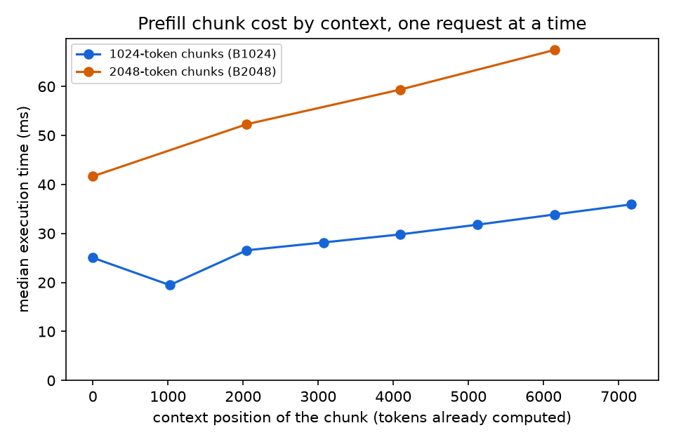

# BottleneckShift Milestone 5 Part 2: context length and the C8 block

## Result

**A prefill chunk's cost grows with its context, at a fixed chunk size** (prediction
12, primary for Part 2, confirmed). With one request at a time and every chunk exactly
the budget's size:
- 1024-token chunks took 19.5 ms at context 1024 and rose steadily to 35.9 ms at
  context 7168;
- 2048-token chunks rose from 41.7 ms at context 0 to 67.4 ms at context 6144.

The deepest chunk cost 1.44× (B1024) and 1.62× (B2048) the first, and the Spearman
correlation between context and execution time was 0.96 in both series. This confirms
the pilot's post hoc observation that same-size steps cost more for longer prompts.
At context 0, a 2048-token chunk took 1.67× a 1024-token chunk (prediction 13,
confirmed).

**The C8 block repeats the pilot's pattern.**
- **The median moves with concurrency (prediction 9, confirmed).** At C8 and budget
  2048, median inter-token latency (ITL) is 4.6–5.8 ms for every prompt length, against
  55–57 ms at C32.
- **The tail prediction (8) was not confirmed,** for the same reason as at C32:
  1024-token prompts were packed into budget-sized steps, so their tail was only 11%
  lower than for 2048-token prompts.
- **Prediction 2 was not confirmed on the C8 block.** The large/small step ratio held
  (9.0×), but the pooled Spearman correlation was 0.57, against a threshold of 0.7. The
  pre-registered rule therefore rejects H's first clause at C8. Most C8 steps are tiny
  decode steps whose intervals barely vary, which weakens a rank statistic (a post hoc
  explanation); the reliance on this statistic is discussed below.
- **Executor timing helps (prediction 14, confirmed).** It tracks a step's tokens
  better than the schedule interval does (Spearman 0.63 against 0.57).
- **Phase D reproduces at C8** within 0.5% (prediction 10).

## Terms used in this report

| Term | Meaning |
|---|---|
| TTFT / E2E | Time to first token / end-to-end latency, from the client; "mean" values average over a run's requests |
| ITL p50 / p99 | Median / 99th percentile of the gaps between streamed tokens, as reported by vLLM's benchmark for each run |
| C1, C8, C32 | Maximum client concurrency of 1, 8, or 32 requests in flight |
| L | Prompt length in tokens; 32-token outputs and 100 prompts per run throughout |
| B, token budget | `max_num_batched_tokens`: the most tokens one engine step may schedule |
| Engine step | One scheduler iteration of the vLLM engine |
| Step log | `steps.jsonl` from the opt-in plugin `src/bottleneckshift/vllm_steplog.py`; in Part 2 it also records each prefill chunk's context position and size, and when each step's results arrive |
| Chunk, context position | A piece of a prompt computed in one step; its context position is the number of the prompt's tokens already computed before it |
| Full chunk | A step with exactly one prefill chunk of exactly B tokens |
| Execution time | t_output[n] − max(t_end[n], t_output[n − 1]): from when a step could start until its results arrive |
| Step interval | Time from one step's start to the next step's start (the pilot's measure) |
| Large / small step | A step scheduling at least 1024 / at most 64 tokens |
| `ctx-budgetB` | Part 2B series: C1, 8192-token prompts, budget B |
| `lenL-budgetB-c8` | Part 2A series (the C8 block) for prompt length L at budget B |

Full definitions and defaults: [`docs/glossary.md`](../docs/glossary.md).

## Provenance and protocol

- **Session:** `milestone5p2-20261029T000043Z`, eight series, 2026-10-29 00:03–00:38
  UTC.
- **Protocol:** the Part 2 addendum of
  [`experiments/milestone5.md`](../experiments/milestone5.md), pre-registered in PR #26,
  merged 2026-10-26 20:16 UTC (13:16 PDT) as `0b8a3f9`, before any Part 2 data. The C8
  block (predictions 8–10) was pre-registered with the pilot in PR #24.
- **Code:** commit `0b8a3f9`, clean worktree, recorded in every manifest.
- **Host:** Hyperstack RTX A4000 (15,352 MiB), driver 580.196.07, Linux 6.14; Python
  3.12.3, vLLM 0.29.0, PyTorch 2.13.0, transformers 5.21.0. transformers was 5.20.2 in
  the pilot session; the version is not pinned.
- **Controls:** as in the pilot: pinned model revision, prefix caching off (confirmed
  in every `server.log`), `--generation-config vllm`, greedy sampling, seed 2027, three
  repetitions, 15-second cooldowns, 32-prompt warm-ups at the measured concurrency,
  `/metrics` scrapes, and GPU and CPU samplers. Each `server.log` records the
  configured budget.
- **Series order (pre-registered):** `ctx-budget1024`, `ctx-budget2048`, then
  `len1024-budget2048-c8`, `len4096-budget8192-c8`, `len4096-budget2048-c8`,
  `len1024-budget8192-c8`, `len2048-budget8192-c8`, `len2048-budget2048-c8`.

## Validation

| Check | Result |
|---|---|
| Measured / warm-up requests | 2,400 measured (8 series × 3 runs × 100); 256 warm-up (8 × 32) |
| Failures, token lengths | Zero failures; exact configured input and output lengths |
| Server count = prompts | Yes, every run (2,656 server requests, including warm-ups) |
| Telemetry max gap | 0.21 s GPU, 1.0 s CPU |
| Step log | Present for every series; every measured step has an output time |
| Archive SHA-256 verified after transfer | Yes (`shasum -a 256 -c`: OK); all eight series also revalidated on the laptop |

## Measurements

### Part 2B: context-length test (C1, L = 8192)

Median execution time of full chunks by context position (300 chunks per position):

| Context position | 0 | 1024 | 2048 | 3072 | 4096 | 5120 | 6144 | 7168 |
|---|---:|---:|---:|---:|---:|---:|---:|---:|
| 1024-token chunks (B1024), ms | 25.0 | 19.5 | 26.6 | 28.2 | 29.8 | 31.8 | 33.9 | 35.9 |
| 2048-token chunks (B2048), ms | 41.7 | | 52.3 | | 59.4 | | 67.4 | |

Decode-only steps took a median 4.2 ms in both series. Client latency per series
(medians across repetitions, with ranges):

| Series | Output tok/s | ITL p50 (ms) | ITL p99 (ms) | Mean TTFT (ms) | Mean E2E (ms) |
|---|---:|---:|---:|---:|---:|
| ctx-budget1024 | 80.7 (80.5–81.3) | 4.2 (4.2–4.2) | 4.9 (4.9–5.0) | 271.7 (269.1–272.2) | 396.3 (393.4–397.1) |
| ctx-budget2048 | 82.8 (82.7–83.0) | 4.2 (4.2–4.2) | 4.9 (4.9–4.9) | 261.1 (260.3–261.5) | 386.2 (385.0–386.7) |

*Median execution time of full prefill chunks by context position, one request at a
time (C1) with 8192-token prompts.* Figure provenance:
[`figures/README.md`](figures/README.md).

### Part 2A: the C8 block

| Series | L | B | Output tok/s | ITL p50 (ms) | ITL p99 (ms) | Mean TTFT (ms) | Mean E2E (ms) |
|---|---:|---:|---:|---:|---:|---:|---:|
| len1024-budget2048-c8 | 1024 | 2048 | 821.8 (819.5–822.0) | 4.6 (4.6–4.6) | 40.4 (40.4–40.6) | 114.3 (113.4–115.2) | 302.6 (302.5–303.5) |
| len2048-budget2048-c8 | 2048 | 2048 | 511.0 (511.0–512.2) | 4.9 (4.9–4.9) | 45.5 (45.5–45.6) | 220.5 (217.3–223.7) | 488.2 (488.0–488.2) |
| len4096-budget2048-c8 | 4096 | 2048 | 272.7 (271.8–273.8) | 5.7 (5.7–5.8) | 53.8 (53.1–54.3) | 393.3 (389.2–394.4) | 922.0 (914.3–925.1) |
| len1024-budget8192-c8 | 1024 | 8192 | 823.0 (819.8–823.0) | 4.6 (4.6–4.6) | 60.4 (59.6–60.7) | 121.2 (120.2–121.4) | 301.9 (301.9–303.1) |
| len2048-budget8192-c8 | 2048 | 8192 | 526.0 (524.7–526.1) | 4.9 (4.9–4.9) | 120.3 (85.9–120.6) | 226.4 (225.7–233.2) | 473.7 (473.7–475.0) |
| len4096-budget8192-c8 | 4096 | 8192 | 287.3 (286.7–288.7) | 5.5 (5.4–5.5) | 177.5 (175.6–177.5) | 492.0 (489.7–493.4) | 869.9 (865.6–871.7) |

Step log, C8 block (all measured runs):

| Series | Steps carrying prefill | Median tokens of a prefill step | Largest step | Large-step interval (ms) | Small-step interval (ms) |
|---|---:|---:|---:|---:|---:|
| len1024-budget2048-c8 | 14% | 2048 | 2048 | 29.0 | 4.6 |
| len2048-budget2048-c8 | 23% | 2048 | 2048 | 42.8 | 4.9 |
| len4096-budget2048-c8 | 40% | 2048 | 2048 | 46.7 | 5.5 |
| len1024-budget8192-c8 | 9% | 2054 | 7169 | 16.5 | 4.6 |
| len2048-budget8192-c8 | 11% | 4097 | 8192 | 27.9 | 4.9 |
| len4096-budget8192-c8 | 14% | 8192 | 8192 | 160.1 | 5.5 |

## Predictions vs observed

| # | Prediction | Observed | Verdict |
|---|---|---|---|
| 1 | (C8 block) No step exceeds B; each run's logged prefill within 1% of 100 × L | Largest step at most B in every series; logged prefill equals 100 × L exactly in all 18 runs | **Confirmed** |
| 2 | (C8 block, pooled) Large-step median interval ≥ 3× small-step; Spearman ≥ 0.7; the ratio in each series with ≥ 30 of each | Ratio 43.8 / 4.9 ms = 9.0× (each series 3.6× to 29×); Spearman 0.57 | **Not confirmed** (ratio held; Spearman below 0.7) |
| 8 | At C8 and B2048: p99 for L1024 at least 25% lower than L2048; L4096 within ±20% | L1024 40.4 vs 45.5 ms (11.2% lower); L4096 53.8 ms (+18.2%) | **Not confirmed** (L4096 part held; L1024 part failed) |
| 9 | At C8 and B2048, ITL p50 below 10 ms for every L (while C32 had at least 20 ms for L2048 and L4096) | 4.6, 4.9, 5.7 ms (C32 pilot: 55.3 and 57.4 ms) | **Confirmed** |
| 10 | C8 L2048/B2048 within 5% of Phase D's `budget-2048-before` at C8 (ITL p50, mean E2E, throughput) | 4.93 vs 4.92 ms (+0.2%); 488.2 vs 486.5 ms (+0.3%); 511.0 vs 513.7 tok/s (−0.5%) | **Confirmed** |
| 11 | (Context series) Every prefill step one full chunk at positions 0, B, …, 8192 − B; prefill totals exact; every step has an output time | 2,400 of 2,400 and 1,200 of 1,200 prefill steps are full chunks at exactly the expected positions (300 per position); totals exact; no step lacks an output time | **Confirmed** |
| 12 (primary, Part 2) | Deepest chunks ≥ 1.2× context-0 chunks; Spearman(context, execution time) ≥ 0.6, in each context series | 35.9 / 25.0 = 1.44× (B1024); 67.4 / 41.7 = 1.62× (B2048); Spearman 0.964 and 0.965 | **Confirmed** |
| 13 | At context 0, a 2048-token chunk takes 1.4× to 2.5× a 1024-token chunk | 41.7 / 25.0 = 1.67× | **Confirmed** |
| 14 | (C8 block) Spearman(tokens, execution time) ≥ Spearman(tokens, schedule interval) | 0.63 vs 0.57 | **Confirmed** |

The Phase D values in prediction 10 were recomputed from the Phase D archive with the
same definitions as this report.

**Falsification.**
- **Part 2B:** prediction 11 holds and prediction 12 holds, so the pilot's post hoc
  context reading is supported.
- **The C8 block:** prediction 1 holds and prediction 2 does not. The pre-registered
  rule says H, that a step's wall time is set mainly by its scheduled tokens, is then
  rejected. Read strictly, the C8 data do not support that clause by the pre-registered
  statistic. The large/small ratio part of prediction 2 did hold, and the Interpretation
  section explains why the rank statistic is weak at C8.
- **Prediction 8** failed in its L1024 part, as prediction 3 did at C32.

## Interpretation

- **Context length is a second driver of step cost (pre-registered, confirmed).** At a
  fixed chunk size, cost rose almost linearly with context: from context 2048 on, about
  1.9 ms per additional 1024 tokens of context for 1024-token chunks, and about 4.3 ms
  per 1024 tokens for 2048-token chunks. The slope roughly doubles with chunk size, which fits attention
  cost growing with chunk size times context. So "step cost tracks step size" holds at
  a given context, and context adds to it. This explains the pilot's post hoc finding
  that 2048-token steps cost 45, 55.5, and 57.7 ms at prompt lengths 1024, 2048, and
  4096.
- **The first chunk of each prompt is slower (post hoc).** At B1024, the context-0
  chunk (25.0 ms) took longer than the context-1024 chunk (19.5 ms), and the curve
  steps up between 1024 and 2048. A plausible cause is per-request work on a request's
  first step. This study did not isolate it.
- **Why prediction 2 failed at C8 (post hoc).** At C8, about 82% of steps schedule at
  most 64 tokens (mostly decode steps of 1 to 8 tokens), and their intervals sit near
  5 ms. Those steps dominate the ranks, and small
  differences among them are noise, so the rank correlation is low even though large
  steps are 9× slower than small ones. The pre-registered statistic was calibrated on
  C32, where steps are more evenly spread in size. The verdict stands as scored; a
  measure robust to this mix would compare step-size bins, as the ratio does.
- **Concurrency moves the median; the budget sets the scale of the tail.** At B2048,
  the median fell from about 55 ms at C32 to about 5 ms at C8, as prediction 9
  expected. The tail fell less (58 to 46 ms at L2048). At B8192, for L2048 and L4096,
  the tail stayed about 2.6–3.3× the B2048 tail at C8, as at C32.
- **Short prompts are packed at C8 too (post hoc).** At L1024 and B2048, the median
  prefill step still carried 2048 tokens, so short prompts did not make steps smaller.
  This is the same failure of H's second clause as in the pilot.

## Limitations

- **One model, one GPU, closed-loop load, synthetic prompts.** The results describe
  this setup only.
- **Execution time is measured at the scheduler,** from when a step could start until
  its results arrive. It includes host-side work, and when the engine schedules early
  it slightly underestimates GPU time.
- **The context test uses C1 and 8192-token prompts only,** with two chunk sizes. The
  per-context slope at other chunk sizes, at higher concurrency, or with mixed decode
  traffic is not measured.
- **One C8 series had an outlying repetition.** `len2048-budget8192-c8` had one run
  with a p99 of 85.9 ms, against about 120 ms for the other two; the median is used.
- **Repetitions replay the same seed-2027 prompts.**

## Execution notes

- **Three VMs failed before any data.** On Oct 26, three Hyperstack A4000 VMs in the
  same region failed GPU initialization ("RmInitAdapter failed", GSP firmware boot
  timeout). Two failed after the driver upgrade and reboot, and one on the stock R570
  driver before any setup. A fourth VM, created later, worked, and the whole session
  ran on it. No series was started on a failed host.
- No series failed or was rerun on the working host. All eight ran in the
  pre-registered order and validated as they finished.

## Recommended next step

- **Write the technical report** from Milestones 1–3 and Milestone 5 (pilot and
  Part 2).
- **For a future study:** model step cost as a function of both scheduled tokens and
  context. Then test whether that model predicts ITL p50 and p99 across concurrency
  levels and budgets, using a step-size measure that is robust to decode-heavy mixes.

## Artifact record

- **Archive:** `milestone5p2-20261029T000043Z.tar.gz` (2.3 MB)
- **SHA-256:** `59bc4f43f08255c6057768ba6fa348666aeb2df38dae362faee36405066dacdb`
- **Contents:** eight series (raw `requests.json`, manifests, server logs, metrics
  scrapes, `steps.jsonl`, `gpu.csv`, `cpu.txt`, per-series `validation.json`), plus the
  host scripts and logs.
- **Analysis:**
  - `analysis/milestone5_part2.py context` on the two context series (predictions
    11–13 and the committed figure `reports/figures/milestone5-part2-context.png`);
  - `analysis/milestone5_part2.py timing` on the C8 block (prediction 14);
  - `analysis/milestone5_steps.py --pooled` on the C8 block (predictions 1, 2, and
    8–10).
- **Before publishing:** remove identifying data. `cpu.txt` contains the hostname, and
  the manifests contain the GPU UUID and host paths. The archive is retained outside
  this repository.
