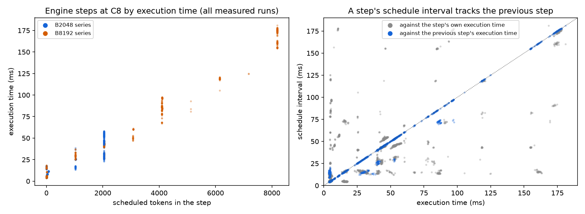

# BottleneckShift reanalysis: step timing, step cost, uncertainty, and clocks

This report reanalyzes data already collected in Milestones 3 and 5. No new data were
collected. Nothing here was pre-registered, and every result is post hoc. Pre-registered
verdicts in earlier reports are unchanged; where this reanalysis bears on one, the
earlier report links here.

## Result

**The Milestone 5 step interval measures the previous step.** In every Part 2 C8 series
the engine scheduled 97–100% of steps before the previous step's results arrived. A
step's schedule interval has a Spearman correlation of 0.95–0.99 with the previous
step's execution time at B2048 (0.74–0.77 at B8192), against 0.62–0.82 with its own.

**With execution time, a step's cost tracks its tokens at C8.** Steps of at least 1024
tokens took 6.6× to 29.6× as long as steps of at most 64 tokens. The per-series Spearman
correlation of tokens with execution time was 0.63–0.89, and 0.63 pooled. The
pre-registered prediction 2 used the interval and stays not confirmed at C8.

**Re-pairing the pilot's C32 intervals gives the same picture.** Pairing each step with
the next step's interval (validated on the C8 data, where it reproduces the
execution-time medians of large steps within 3%), large steps took 9.9× small ones
pooled at C32, with a Spearman correlation of 0.92.

**A four-term step-cost model predicts the tail.** Execution time ≈ fixed cost +
per-token cost + attention cost + decode KV cost fits 30,789 Part 2 steps with
R² = 0.993. Fit only on the one-request context series, it predicts ITL p99 of every C8
series within 0–5%. Its linear and attention terms imply 40–45 and 36–44 TFLOPS, about
half of the A4000's dense 16-bit tensor peak; its decode KV term is not identified by
these data.

**Mean TTFT at C32 is dominated by each run's start-up burst.** Dropping the first and
last C requests of each run leaves ITL p50 and p99 within about 1% in most cells, but
mean TTFT at C32 and B2048 falls by about half (Phase C: 431 → 255 ms).

**The GPU ran at its power limit under load.** Median power was 135–140 W against a
140 W board limit, and the median SM clock varied from 1440 to 1860 MHz across
conditions and repetitions. Clocks were not locked.

## Terms used in this report

| Term | Meaning |
|---|---|
| Schedule interval | Time from one step's scheduling call to the next step's (the pilot's measure; gaps over 1 s dropped) |
| Execution time | t_output[n] − max(t_end[n], t_output[n−1]): from when a step could start until its results arrived (Part 2 logs only) |
| Large / small step | At least 1024 / at most 64 scheduled tokens, as in prediction 2 |
| Re-paired interval | A step's cost estimated by the *next* step's schedule interval |
| Steady state | A run's requests without the first C by start time and the last C by finish time |
| C1, C8, C32 | Maximum client concurrency of 1, 8, or 32 requests in flight |

## Data and method

- **Data:** the retained archives of Phase B (`20261003T180358Z`), Phase C
  (`20261003T201214Z`), Phase D (`20261006T022744Z`), the Milestone 5 pilot
  (`20261025T004640Z`) and Part 2 (`20261029T000043Z`). Every series passes
  `scripts/validate_results.py` checks (via `validate_series`) before use. Warm-ups are
  excluded.
- **Scripts:** `analysis/reanalysis_steps.py` (step logs: modes `lag`, `execution`,
  `fit`, `figure`) and `analysis/reanalysis_requests.py` (client results and telemetry:
  modes `check`, `uncertainty`, `steady`, `clusters`, `clocks`). Commands are in
  [Reproduce](#reproduce).
- **Checks of the client data.** vLLM's `median_itl_ms`, `p99_itl_ms`, and
  `mean_itl_ms` are numpy's default (linear) percentiles of a run's pooled per-request
  gaps; the reanalysis reproduces them in all 171 measured runs to within 1e-13 ms.
  Per-request E2E is TTFT plus the sum of the request's gaps. Some 32-token requests have
  29 or 30 gaps (85 of all requests), so per-request time per output token divides by
  the actual gap count.

## 1. Step timing lag

Part 2 C8 block (all measured runs):

| Series | Scheduled early | Spearman(interval, own execution) | Spearman(interval, previous execution) |
|---|---:|---:|---:|
| len1024-budget2048-c8 | 100% | 0.69 | 0.96 |
| len2048-budget2048-c8 | 100% | 0.81 | 0.98 |
| len4096-budget2048-c8 | 100% | 0.82 | 0.99 |
| len1024-budget8192-c8 | 97% | 0.65 | 0.74 |
| len2048-budget8192-c8 | 97% | 0.62 | 0.74 |
| len4096-budget8192-c8 | 97% | 0.67 | 0.77 |



*Left: every measured C8 step's execution time against its scheduled tokens. Right: each
step's schedule interval against its own execution time (gray) and the previous step's
(blue); the dotted line is equality.* Figure provenance: `analysis/reanalysis_steps.py
figure` over the six Part 2 C8 series.

The interval of a step mostly reflects the previous step, so a large step's own cost
appears in the next interval. That explains the physically impossible intervals noted in
the [pilot correction](milestone5-20261025T004640Z-pilot.md#correction-2026-10-28): at
L1024/B8192, large steps' median interval was 16.5 ms, but their median execution time
was 42.2 ms.

## 2. C8 step cost by execution time

| Series | Large-step execution (ms) | Small-step execution (ms) | Ratio | Spearman(tokens, execution) |
|---|---:|---:|---:|---:|
| len1024-budget2048-c8 | 30.3 | 4.56 | 6.6× | 0.63 |
| len2048-budget2048-c8 | 43.1 | 4.87 | 8.9× | 0.77 |
| len4096-budget2048-c8 | 50.0 | 5.51 | 9.1× | 0.89 |
| len1024-budget8192-c8 | 42.2 | 4.55 | 9.3× | 0.66 |
| len2048-budget8192-c8 | 81.7 | 4.84 | 16.9× | 0.75 |
| len4096-budget8192-c8 | 161.1 | 5.44 | 29.6× | 0.73 |
| Pooled | 45.4 | 4.83 | 9.4× | 0.63 |

Four of six series clear prediction 2's 0.7 threshold by execution time, and the pooled
value does not. Pooled ranks are dominated by small steps, whose costs vary with context
and host work rather than token count. About 3% of steps of at most 64 tokens took over
10 ms in four of the six series; we did not explain them.

The step log also shows the first-chunk effect in Part 2B is specific to that design. At
C8 and L1024/B2048, a lone 1024-token chunk at context 0 with no decodes took a median
16.2 ms (36 steps), against 25.0 ms for the first chunk of an 8192-token prompt at C1.
The Part 2 report's "per-request setup" reading does not explain the difference.

## 3. Pilot C32, re-paired

Each step's cost is taken as the next step's interval. On the C8 data, this re-pairing
gives large-step medians within 3% of execution time in every series (for example 42.3
against 42.2 ms at L1024/B8192), though its rank correlation is lower at B8192.

| Series | Large (ms) | Small (ms) | Ratio | Spearman |
|---|---:|---:|---:|---:|
| anchor-before | 55.7 | 5.59 | 10.0× | 0.79 |
| len1024-budget2048 | 45.0 | 5.65 | 8.0× | 0.92 |
| len4096-budget2048 | 57.7 | 5.57 | 10.4× | 0.58 |
| len1024-budget8192 | 78.7 | 5.63 | 14.0× | 0.74 |
| len2048-budget8192 | 157.8 | 6.83 | 23.1× | 0.84 |
| len4096-budget8192 | 190.3 | 9.05 | 21.0× | 0.94 |
| anchor-after | 55.7 | 5.61 | 9.9× | 0.80 |
| Pooled | 56.5 | 5.71 | 9.9× | 0.92 |

The large-step median at len1024-budget8192 rises from 46.3 ms (pilot interval) to
78.7 ms, which fits steps of about 4,098 prompt tokens.

## 4. A step-cost model

The model is t = a + b·tokens + c·attention + e·decode_kv, where `attention` sums
n·(context + n/2) over a step's prefill chunks and `decode_kv` is the computed tokens of
the step's decoding requests. Effective rates use Qwen2.5-0.5B's shapes (0.72 GFLOP per
token in the linear layers; 4·14·64·24 FLOPs per attention pair; 12 KiB of KV per
token).

| Fitted on | Steps | R² | Fixed (ms) | Linear (TFLOPS) | Attention (TFLOPS) | Decode KV (GB/s) |
|---|---:|---:|---:|---:|---:|---:|
| All Part 2 series | 30,789 | 0.993 | 3.8 | 43.5 | 42.1 | 185 |
| C1 context series only | 22,200 | 0.997 | 2.5 | 40.5 | 43.9 | 59 |
| C8 block only | 8,589 | 0.990 | 4.5 | 45.4 | 36.0 | 320 |

Out of sample, ITL from the model fit on the C1 context series alone (each step weighted
by its decode tokens) against vLLM's client ITL:

| C8 series | Client p50 / p99 (ms) | Model p50 / p99 (ms) | Median error, prompt steps |
|---|---|---|---:|
| len1024-budget2048 | 4.60 / 40.4 | 4.40 / 41.6 | 9.1% |
| len2048-budget2048 | 4.93 / 45.5 | 6.12 / 45.4 | 1.9% |
| len4096-budget2048 | 5.75 / 53.8 | 9.56 / 56.8 | 2.0% |
| len1024-budget8192 | 4.57 / 60.4 | 4.40 / 61.0 | 18.2% |
| len2048-budget8192 | 4.87 / 120.3 | 6.12 / 125.7 | 4.4% |
| len4096-budget8192 | 5.46 / 177.5 | 9.55 / 183.6 | 4.8% |

- **The tail is predicted** within 0–5% from one-request data, because p99 is set by
  prompt-carrying steps, whose cost the linear and attention terms capture.
- **The median is not**, at long prompts: the decode KV term is poorly identified at C1,
  where every decode step has about the same context.
- **Execution time reproduces the client's ITL.** Weighting measured execution times the
  same way gives ITL p50 within 2% and p99 within 6% of the client's in every Part 2
  series.
- **Packed short prompts are cheaper than the model predicts** (the 9–18% errors at
  L1024), consistent with the first-chunk effect above.
- The linear and attention rates agree across fits. Prompt work runs at about half the
  A4000's dense 16-bit tensor peak (76.7 TFLOPS).

## 5. Uncertainty

Values are the median of three repetitions, with the min–max across repetitions. The
bootstrap resamples requests within each run (2,000 resamples) and gives the 95%
interval of the median-of-runs statistic.

| Cell | ITL p50 (ms) | ITL p99 (ms) | Mean TTFT (ms) | Output tok/s |
|---|---|---|---|---|
| Phase D, C32, B512 | 15.80 (15.77–15.81) | 17.79 (17.68–17.79) | 1378.8 (1377.5–1380.6) | 496.2 (496.0–496.5) |
| Phase D, C32, B2048 | 55.36 (55.31–55.77) | 58.65 (58.40–58.70) | 432.7 (422.0–436.6) | 550.8 (550.3–552.2) |
| Phase D, C32, B8192 | 6.94 (6.89–6.95) | 168.72 (168.08–170.32) | 686.1 (661.0–692.2) | 652.5 (652.5–652.9) |
| C32, L1024/B2048 | 6.08 (5.92–6.18) | 47.36 (47.29–47.71) | | |
| C32, L4096/B2048 | 57.40 (57.37–57.71) | 64.73 (64.44–64.77) | | |
| C32, L4096/B8192 | 9.66 (9.54–9.79) | 199.92 (198.65–200.23) | | |
| C8, L2048/B8192 | 4.87 (4.86–4.87) | 120.26 (85.93–120.55) | | |

- **Repetitions agree closely.** ITL and throughput ranges are within about 1% in most
  cells. One exception: one C8 L2048/B8192 run had a p99 of 85.9 ms against about 120 ms
  for the other two.
- **The bootstrap understates spread.** Resampling requests within runs gives intervals
  narrower than the run ranges for ITL p99 (for example 119.6–120.9 ms in that cell), so
  run-level ranges are the better guide here. For mean TTFT the bootstrap intervals are
  about ±10%, wider than the run ranges.
- **The orderings hold.** Every ordering the reports rank, such as Table 1's p50 and p99
  orders and the B2048 p99 order across prompt lengths, is separated beyond both the run
  ranges and the bootstrap intervals.

## 6. Steady state

Full runs against steady-state requests (median of runs):

| Cell | ITL p50 | ITL p99 | Mean TTFT |
|---|---|---|---|
| Phase C forward, C8 | +0.3% | +0.1% | 215.2 → 212.2 ms |
| Phase C forward, C16 | +0.4% | −0.3% | 296.9 → 267.4 ms |
| Phase C forward, C32 | +1.0% | +0.5% | 430.9 → 255.0 ms |
| Phase D, C32, B512 | +0.9% | −0.2% | 1378.8 → 1541.7 ms |
| Phase D, C32, B2048 | +1.1% | +0.2% | 432.7 → 217.0 ms |
| Phase D, C32, B8192 | +0.5% | 0.0% | 686.1 → 608.7 ms |
| C32, L1024/B2048 | +8.2% | +1.4% | 267.0 → 197.0 ms |
| C8 block (six cells) | at most 0.6% | at most 1.1% | −0.1% to −2.6% |

- **ITL is a steady-state property.** At C32 only 36 of 100 requests per run remain, yet
  ITL p50 and p99 barely change.
- **Mean TTFT at C32 is not.** The first 32 requests arrive together and wait for one
  another's prefills. From C8 to C32 in steady state, mean TTFT rises from 212 to
  255 ms (+20%), against 215 to 431 ms over full runs.
- **The budget's TTFT order holds in steady state** (512 > 8192 > 2048), and widens.

## 7. ITL clusters

Phase D sweep, forward order (the reverse order agrees within 1 point):

| Concurrency | Gaps above 20 ms | Mean ITL (ms) | ITL p50 (ms) | ITL p99 (ms) |
|---|---:|---:|---:|---:|
| C8 | 9.6% | 8.65 | 4.92 | 45.2 |
| C12 | 20.6% | 13.32 | 5.12 | 46.9 |
| C16 | 30.5% | 18.02 | 5.53 | 49.1 |
| C24 | 56.2% | 30.48 | 45.80 | 53.4 |
| C32 | 80.2% | 45.12 | 55.59 | 59.0 |

Gaps fall into two clusters, below 10 ms and 40–80 ms; the 10–40 ms bins hold about 10%
of gaps or fewer at every concurrency. The median jumps between C16 and C24 because the share of
long gaps crosses one half there. Mean ITL rises steadily. This qualifies the Phase D
primary prediction's "transition between C16 and C24": the jump is a property of the
median of a two-cluster distribution. Mean ITL equals mean per-request time per output
token after the first to within 0.01 ms in every cell.

## 8. Clocks and power

Within each run's benchmark window (the window `analysis/phases.py` uses):
- **Power:** under load, median power was 135–140 W and maximum about 141 W, against the
  board's 140 W limit. The highest clock in each session's log, 1935 MHz, appears only
  briefly, so a "below maximum" flag marks every run and is not informative.
- **SM clock by condition:** C1 runs ran at 1710–1785 MHz; C8 to C32 prefill-heavy runs
  at 1440–1800 MHz, most near 1485 MHz. Repetitions of one cell sometimes differ by 200–300 MHz, for example
  1800, 1770, and 1485 MHz in the sweep's forward C8.
- **Contention lowered the clock.** At C1, off and sham runs ran at a median
  1740 MHz (1710–1785) and the 50% contention runs at 1680 MHz (1650–1680), about 3–4%
  lower, with median power 133–137 W against 130–131 W. Part of contention's slowdown at C1 (+22.5% prefill,
  +11.3% decode) may come from the lower clock.
- **B8192 at C32** ran 2–3% below B2048 (1440–1455 against 1485 MHz).
- **Window check:** each run's manifest window spans about 20 s for a 5–6 s benchmark,
  with 13–20 s of client start-up at the beginning. The benchmark window holds 0–4 idle
  samples, so the GPU utilization means in earlier reports are not diluted by idle tail.

## Effects on earlier reports and the technical report

- [Milestone 5 pilot](milestone5-20261025T004640Z-pilot.md) and
  [Part 2](milestone5p2-20261029T000043Z-part2.md): sections 1–3 confirm the lag their
  corrections describe and supply execution-time and re-paired step costs. Section 2
  revises Part 2's post hoc reading of the first chunk.
- [Phase C](milestone3-20261003T201214Z-phase-c.md): the C8 to C32 TTFT rise is mostly
  start-up (section 6), and contention co-varies with a 3–4% lower clock (section 8).
- [Phase D](milestone3-20261006T022744Z-phase-d.md): the C16 to C24 transition is a
  crossing of the median (section 7).
- The technical report is updated to cite this reanalysis.

## Limitations

- **Post hoc.** The analyses, thresholds such as 20 ms, and the model form were chosen
  after seeing the data.
- **The model is fit and tested on one GPU and model,** and its decode term is not
  identified.
- **Execution time exists only in Part 2** (C1 and C8). The C32 re-pairing is an
  estimate, validated only at C8.
- **Steady state** uses 36 of 100 requests per run at C32; longer runs would measure it
  directly.
- **Clocks were sampled every 200 ms** with no throttle-reason field, so the cause of
  clock changes is inferred from power.

## Reproduce

From the repository root, with the archives extracted under `results/archives/`:

```
P1=results/archives/milestone5-20261025T004640Z/extract/BottleneckShift/results/runs
P2=results/archives/milestone5p2-20261029T000043Z/extract/BottleneckShift/results/runs
python analysis/reanalysis_steps.py lag $P2/*c8 $P1/*
python analysis/reanalysis_steps.py execution $P2/*c8
python analysis/reanalysis_steps.py fit $P2/*
python analysis/reanalysis_steps.py fit $P2/* --train=ctx-
python analysis/reanalysis_steps.py fit $P2/* --train=-c8
python analysis/reanalysis_steps.py figure $P2/*c8 --output reports/figures/reanalysis-step-timing.png
python analysis/reanalysis_requests.py check
python analysis/reanalysis_requests.py uncertainty
python analysis/reanalysis_requests.py steady
python analysis/reanalysis_requests.py clusters
python analysis/reanalysis_requests.py clocks
```
